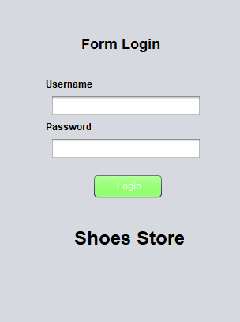
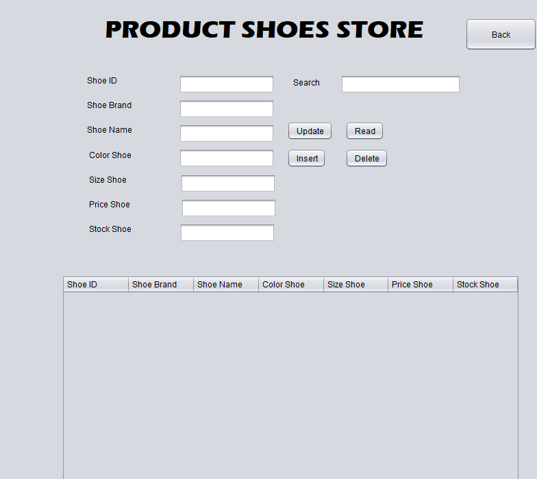

# Shoe Store CRUD

Aplikasi desktop untuk mengelola data produk sepatu, pelanggan, pegawai, dan pemasok. Antarmuka memakai Java Swing dengan form NetBeans, sedangkan data tersimpan di Microsoft SQL Server.

Repository: [zalamanga/shoe-store-crud-](https://github.com/zalamanga/shoe-store-crud-).

## Fitur

- Login menggunakan akun aplikasi pada tabel `dbo.login`.
- Menu Product, Customer, Employee, dan Supplier.
- Menampilkan, menambah, mencari, mengubah, dan menghapus data pada setiap modul.
- Memilih baris tabel untuk mengisi form sebelum mengubah atau menghapus data.
- Konfigurasi koneksi database melalui file lokal atau environment variable.

Project ini mengelola data master toko. Login mempertahankan format password teks biasa dari aplikasi lama untuk kompatibilitas database. Gunakan akun khusus pengembangan; autentikasi ini belum sesuai untuk penggunaan produksi.

## Tampilan



Form login dari komponen Swing aplikasi.



Form Product dalam keadaan kosong. Klik Read dengan koneksi SQL Server yang sudah diatur untuk memuat data. Gambar ini memperlihatkan komponen antarmuka, bukan hasil pengujian database.

## Teknologi dan kebutuhan

| Komponen | Kebutuhan |
| --- | --- |
| Bahasa dan UI | Java 11 atau lebih baru, Java Swing |
| Database | Microsoft SQL Server yang dapat diakses melalui TCP |
| Driver | Microsoft JDBC Driver for SQL Server, diambil melalui `build.ps1` |
| Build terminal | PowerShell dan JDK; atur `JAVA_HOME` atau sediakan `java`, `javac`, serta `jar` di PATH |
| Editor opsional | Apache NetBeans untuk project Java Ant dan penyuntingan form |
| Pengaturan database | SQL Server Management Studio (SSMS) atau klien SQL Server lain yang mendukung batch `GO` |

## Mulai dari terminal

Contoh perintah berikut memakai PowerShell. Jalankan dari folder project yang berisi `build.ps1`.

```powershell
git clone https://github.com/zalamanga/shoe-store-crud-.git
Set-Location -LiteralPath '.\shoe-store-crud-'
java -version
javac -version
```

Jika project sudah ada di komputer, langsung buka folder project tersebut. Lanjutkan dengan pengaturan database sebelum menjalankan aplikasi.

### 1. Siapkan database

1. Sambungkan SSMS ke SQL Server pengembangan.
2. Buka dan jalankan [database/schema.sql](database/schema.sql). Script membuat database `SHOEStoremanaj` dan tabel yang belum ada. Script tidak menghapus data atau mengubah tabel yang sudah ada.
3. Siapkan akun koneksi SQL Server yang memiliki akses ke database tersebut. Akun ini digunakan pada `db.user` dan `db.password`.
4. Buat akun untuk masuk ke aplikasi. Pada database `SHOEStoremanaj`, jalankan contoh berikut setelah mengganti kedua placeholder:

```sql
USE SHOEStoremanaj;
GO

INSERT INTO dbo.login (username, password)
VALUES (N'GANTI_USERNAME_APLIKASI', N'GANTI_PASSWORD_APLIKASI');
GO
```

Tidak ada akun aplikasi atau password bawaan. Akun pada `dbo.login` berbeda dari akun koneksi SQL Server. Jika database lama sudah berisi akun dan tabel, periksa skemanya sebelum menjalankan perubahan. Script ini bukan migrasi untuk menyesuaikan struktur tabel lama.

| Tabel | Data |
| --- | --- |
| `dbo.product` | ID, merek, nama, warna, ukuran, harga, stok sepatu |
| `dbo.customer` | ID, nama, alamat, nomor telepon pelanggan |
| `dbo.employee` | ID, nama, alamat, nomor telepon pegawai |
| `dbo.supplier` | ID, nama, alamat, merek, nomor telepon pemasok |
| `dbo.login` | Username dan password akun aplikasi |

### 2. Atur koneksi

Salin file contoh:

```powershell
Copy-Item -LiteralPath '.\database.properties.example' -Destination '.\database.properties'
notepad .\database.properties
```

Isi `db.user` dan `db.password` dengan akun koneksi SQL Server. Sesuaikan host, port, serta nama database pada `db.url`.

```properties
db.url=jdbc:sqlserver://localhost:1433;databaseName=SHOEStoremanaj;encrypt=true;trustServerCertificate=true;loginTimeout=5;socketTimeout=10000
db.user=GANTI_USER_DATABASE
db.password=GANTI_PASSWORD_DATABASE
```

`trustServerCertificate=true` pada contoh ditujukan untuk SQL Server lokal dengan sertifikat mandiri. Untuk server dengan sertifikat tepercaya, gunakan konfigurasi sertifikat server yang sesuai.

`database.properties` masuk `.gitignore`. Simpan kredensial asli pada file lokal tersebut, bukan pada file contoh atau source. Jangan menyalin ulang file contoh jika file lokal sudah berisi konfigurasi yang diperlukan.

Kode lama pernah menyimpan kredensial SQL Server di source dan riwayat Git. Memindahkan konfigurasi tidak menghapus riwayat tersebut; ganti password SQL Server lama jika masih dipakai.

| Environment variable | Menggantikan properti |
| --- | --- |
| `SHOE_DB_URL` | `db.url` |
| `SHOE_DB_USER` | `db.user` |
| `SHOE_DB_PASSWORD` | `db.password` |

Jika environment variable didefinisikan, nilainya menggantikan properti terkait. Nilai kosong ditolak sebagai konfigurasi yang belum lengkap. Untuk lokasi file konfigurasi lain, gunakan system property Java `-Dshoe.db.config=path-ke-file.properties`.

### 3. Build, uji, dan jalankan

```powershell
powershell -ExecutionPolicy Bypass -File .\build.ps1 -Task Build
powershell -ExecutionPolicy Bypass -File .\build.ps1 -Task Test
powershell -ExecutionPolicy Bypass -File .\build.ps1 -Task FetchDriver
powershell -ExecutionPolicy Bypass -File .\build.ps1 -Task Run
```

`Build` dan `Test` dapat dijalankan tanpa mengunduh driver. `FetchDriver` memerlukan internet untuk mengunduh driver Microsoft dari Maven Central dan memeriksa checksum. `Run` memerlukan driver yang sudah tersedia serta SQL Server dan konfigurasi koneksi yang benar. Pengaturan execution policy pada perintah tersebut hanya berlaku untuk proses PowerShell yang dijalankan.

Login menggunakan akun yang dibuat pada `dbo.login`, lalu pilih modul dari menu utama. Setelah build dan driver tersedia, aplikasi juga dapat dijalankan dari folder project dengan:

```powershell
java -jar .\dist\shoe-store.jar
```

## Menjalankan melalui NetBeans

1. Jalankan task `FetchDriver` dari folder project satu kali untuk menyiapkan driver lokal.
2. Di NetBeans, pilih Open Project dan buka folder project ini.
3. Pilih platform JDK 11 atau lebih baru pada pengaturan project.
4. Siapkan database dan `database.properties` sesuai langkah di atas.
5. Jalankan Clean and Build, kemudian Run. Main class adalah `shoe.store.login_page`.

File `.form` dipertahankan agar form tetap dapat dibuka melalui GUI Builder NetBeans. Pengaturan pribadi IDE pada `nbproject/private/` tidak ikut repository.

## Menggunakan modul CRUD

1. Klik Read untuk memuat daftar data.
2. Isi semua field, lalu klik Insert untuk menambah data.
3. Ketik kata pencarian untuk memfilter data.
4. Pilih satu baris, ubah field yang diperlukan, lalu klik Update.
5. Pilih satu baris, klik Delete, dan periksa konfirmasinya sebelum menghapus.
6. Klik Back untuk kembali ke menu utama.

Semua field wajib diisi. Ukuran sepatu harus berupa angka lebih dari nol, harga minimal nol, dan stok berupa bilangan bulat minimal nol. Ukuran dan harga menerima maksimal dua digit desimal; gunakan titik sebagai pemisahnya. Batas nilai mengikuti skema pada `schema.sql`. Nomor telepon disimpan sebagai teks sehingga angka nol di awal dapat dipertahankan.

Update dan Delete memakai ID asli dari baris yang dipilih. ID dapat diubah melalui Update; perubahan tetap diarahkan ke baris semula. Pencarian memperlakukan karakter seperti `%`, `_`, dan `[` sebagai teks pencarian.

Setelah perubahan tersimpan, aplikasi memuat ulang tabel serta mengosongkan pencarian dan form. Jika penyimpanan berhasil tetapi tabel gagal dimuat ulang, pesan aplikasi membedakan kedua hasil tersebut.

## Struktur project

```text
src/shoe/store/              Source Java dan form Swing NetBeans
  login_page.java           Form login dan titik masuk aplikasi
  MenuUtama.java            Navigasi ke empat modul
  Product.java              Form produk sepatu
  Customer.java             Form pelanggan
  Employee.java             Form pegawai
  Supplier.java             Form pemasok
  Database.java             Pembacaan konfigurasi dan koneksi SQL Server
  LoginService.java         Pemeriksaan akun aplikasi
  CrudTableController.java  Operasi database dan perilaku tabel empat modul
  AppUi.java                Pengaturan tampilan dan pembukaan form
database/schema.sql         Skema awal tanpa data atau akun bawaan
database.properties.example Contoh konfigurasi tanpa kredensial asli
test/                       Pemeriksaan otomatis
docs/UJI-MANUAL.md           Langkah uji aplikasi dengan SQL Server
build.ps1                   Build, pengujian, driver, dan menjalankan aplikasi
build.xml, nbproject/        Metadata build Ant dan project NetBeans
```

Folder `build/`, `dist/`, driver hasil unduhan dalam `lib/`, konfigurasi lokal, dan metadata pribadi IDE tidak dimasukkan ke Git.

## Pengujian

Jalankan task `Test` untuk pemeriksaan otomatis. Gunakan [checklist uji manual](docs/UJI-MANUAL.md) untuk memeriksa login, setiap operasi CRUD, pencarian, validasi, dan persistensi data terhadap SQL Server.

Verifikasi yang sudah dijalankan:

| Pemeriksaan | Hasil |
| --- | --- |
| Build | Lulus menggunakan JDK 17 dengan target Java 11. |
| Tes otomatis | Tiga kelas tes lulus: `DatabaseTest`, `LoginServiceTest`, dan `CrudTableControllerTest`. Pengujian memakai koneksi JDBC tiruan, tanpa database nyata. |
| Form Swing | Keenam form berhasil dibuat, diatur layout-nya, dan ditutup melalui EventQueue. |
| Integrasi SQL Server | Belum diuji terhadap SQL Server aktual atau seluruh alur interaksi GUI. |

Catat lingkungan serta hasil uji manual sebelum memakai aplikasi dengan data kerja.

## Jika gagal dijalankan

| Gejala | Pemeriksaan |
| --- | --- |
| `java` atau `javac` tidak dikenali | Pastikan JDK terpasang dan folder `bin` JDK tersedia di PATH, lalu buka ulang terminal. Script build juga dapat mencari JDK melalui `JAVA_HOME`. |
| Driver SQL Server tidak ditemukan | Jalankan task `FetchDriver` dari folder project dan ulangi Run. |
| Konfigurasi database belum lengkap | Isi `db.url`, `db.user`, dan `db.password`; periksa juga environment variable yang dapat menggantinya. |
| Koneksi ke SQL Server gagal | Cocokkan host/port pada URL dengan SQL Server yang aktif dan dapat diakses melalui TCP. |
| Login SQL Server gagal | Periksa akun koneksi dan aksesnya ke `SHOEStoremanaj`. Ini berbeda dari akun login aplikasi. |
| Login aplikasi ditolak | Periksa akun pada `dbo.login` di database yang dipakai koneksi. |
| Tabel tidak ditemukan | Jalankan skema awal pada server yang benar dan cocokkan `databaseName` pada URL. |
| Data tidak dapat disimpan | Periksa ID yang sudah dipakai, field wajib, nilai angka, dan batas kolom pada `schema.sql`. |
