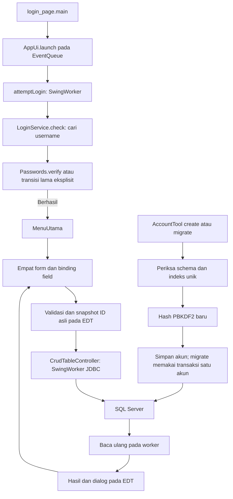

# Alur kode Shoe Store CRUD

Swing mengelola empat data master: Product, Customer, Employee, dan Supplier. JDBC menyimpan perubahan di SQL Server. Keranjang, pesanan, pembayaran, dan transaksi penjualan berada di luar fitur aplikasi ini.

## Login dan perubahan format password

[`login_page.main()`](../src/shoe/store/login_page.java) membuka form melalui [`AppUi.launch()`](../src/shoe/store/AppUi.java) pada EventQueue. `attemptLogin()` memeriksa isian kosong, menonaktifkan kontrol, lalu memanggil [`LoginService.check()`](../src/shoe/store/LoginService.java) di SwingWorker. Char array dari field password dibersihkan setelah pemeriksaan selesai.

Login mengambil kolom `password` dengan parameter username saja. [`Passwords.verify()`](../src/shoe/store/Passwords.java) memeriksa hash PBKDF2-HMAC-SHA256 di Java dan membandingkan hasil dengan `MessageDigest.isEqual`. Parameter hash dibatasi sebelum derivasi. Format hash yang rusak tidak pernah dicoba sebagai plaintext. Username ganda pada schema lama diperlakukan sebagai kegagalan database.

Secara default, akun plaintext menghasilkan pesan migrasi. `SHOE_ALLOW_LEGACY_PASSWORDS=true` mengizinkan transisi sementara dengan peringatan yang terlihat. Login tidak menulis atau memigrasikan akun. Tidak ada role, objek sesi otorisasi, atau filter akses data per pengguna. Form modul masih mempunyai entry point pengembangan sendiri; hak database berasal dari akun koneksi operator.

[`AccountTool`](../src/shoe/store/AccountTool.java) meminta password melalui console interaktif. `create` menyimpan hash saja. `migrate` memeriksa indeks unik username dan kapasitas kolom, mengunci satu baris dengan `UPDLOCK, HOLDLOCK` dalam transaksi, memeriksa password lama, lalu memperbarui baris itu. Kegagalan mencoba rollback; kesalahan konfirmasi commit tetap perlu diperiksa sebelum diulang. Tool tidak mengubah schema atau akun lain. [Langkah migrasi](../README.md#jika-memakai-akun-dari-database-lama) menjelaskan transisi operator.

## Konfigurasi dan koneksi

[`Database.getConnection()`](../src/shoe/store/Database.java) membaca `database.properties` atau path dari system property `shoe.db.config`. `SHOE_DB_URL`, `SHOE_DB_USER`, dan `SHOE_DB_PASSWORD` menggantikan nilai file bila didefinisikan. Nilai kosong ditolak, dan URL harus memakai JDBC SQL Server. Akun koneksi ini berbeda dari akun `dbo.login`.

Koneksi, statement, dan result set ditutup dengan try-with-resources. Query mempunyai timeout sepuluh detik; login/socket timeout diatur pada URL koneksi. Log CRUD/login memuat SQLState dan kode kesalahan, tanpa mencetak query berisi input atau kredensial koneksi.

## Binding form dan pekerjaan latar belakang

[`Product`](../src/shoe/store/Product.java), [`Customer`](../src/shoe/store/Customer.java), [`Employee`](../src/shoe/store/Employee.java), dan [`Supplier`](../src/shoe/store/Supplier.java) memasang [`CrudTableController`](../src/shoe/store/CrudTableController.java) dengan urutan kolom, field, tabel, pencarian, serta tombol masing-masing. File NetBeans `.form` tetap dipertahankan. Validator Product menormalkan angka tanpa pembulatan dan memeriksa batas schema.

Semua pembacaan field, validasi, pilihan baris, perubahan model, dan dialog berlangsung pada EDT. `SwingWorker.doInBackground()` menjalankan JDBC dari snapshot nilai yang sudah diambil. Kontrol CRUD dinonaktifkan selama worker aktif, sehingga klik berulang tidak membuat write kedua. Judul jendela dan cursor menunjukkan proses loading atau saving.

Perubahan dokumen pencarian memakai Timer 250 milidetik. Filter menjadi parameter LIKE untuk setiap kolom; `%`, `_`, `[` dan `~` dicari sebagai teks biasa. Versi permintaan mencegah hasil baca lama menggantikan pencarian terbaru. Permintaan terbaru yang menunggu dijalankan setelah worker sebelumnya selesai. Gagal membaca mempertahankan tabel dan isian sebelumnya.

Pilihan baris dikonversi dari indeks view ke model agar sorting tetap benar. `selectedId` menyimpan ID asli. Update boleh mengubah field ID, tetapi kondisi WHERE tetap memakai ID asli. Delete menyimpan ID yang dikonfirmasi sebelum dialog modal dan tidak memakai ID baru yang diketik.

## Hasil simpan, penutupan, dan batas persistensi

CRUD menjalankan satu statement autocommit, lalu membaca ulang daftar dengan koneksi baru. Tidak ada transaksi bisnis lintas tabel, versi record untuk edit bersamaan, atau kunci idempotensi. Nol baris terpengaruh tidak dianggap sukses.

Simpan berhasil tetapi refresh gagal menghasilkan pesan khusus bahwa data sudah tersimpan. Kegagalan eksekusi tulis dapat berarti hasil server belum terkonfirmasi; aplikasi meminta Read sebelum mengulang dan tidak melakukan retry write otomatis. Data yang sudah berhasil disimpan tetap berada di SQL Server, sedangkan field belum tersimpan hanya berada di form.

Back dan event tutup jendela ditolak dengan pesan tunggu selama write dan refresh berlangsung. Saat hanya membaca, form boleh ditutup; worker dibatalkan dan hasil terlambat tidak menyentuh form atau membuka dialog. [`database/schema.sql`](../database/schema.sql) membuat tabel awal yang belum ada, tanpa akun bawaan, reset, atau perubahan otomatis pada tabel lama.
